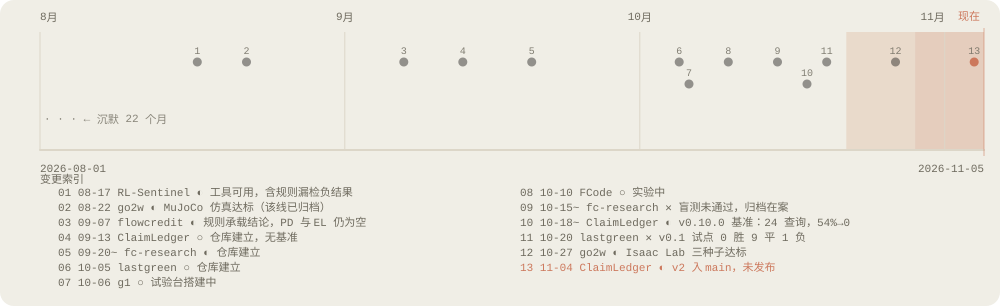

# Eason

[中文](README.md) · [English](README.en.md) · [Visual home ↗](https://anhao1314.github.io)

Independent researcher. One question: **how the conclusions of complex systems stop masquerading as the present.** Research hypothesis: [life-finds-a-way](https://github.com/Anhao1314/life-finds-a-way).

> People define the problems worth solving. AI explores the paths. Real evidence decides what survives.

🔭 **Observation point**　2026-08-01 → 2026-11-05

## Main line

[**ClaimLedger**](https://github.com/Anhao1314/ClaimLedger) — a decision ledger for AI agents: **claim + status + provenance**; conflicts require explicit supersession or dispute, `--at` rebuilds any instant.

`v0.10.0` · macOS / Linux · stdlib only · [benchmark report](https://github.com/Anhao1314/ClaimLedger/blob/main/benchmarks/benchmark-results.md) · [releases](https://github.com/Anhao1314/ClaimLedger/releases/latest)

The benchmark is synthetic (40 sessions / 24 queries): **small n, do not extrapolate**; Recall@5 falls to 0.50 on conflict queries. No vector DB, auto capture, daemon or cloud sync.

## Claim ledger

| Claim | Evidence · since | Status |
| --- | --- | :---: |
| [ClaimLedger](https://github.com/Anhao1314/ClaimLedger): stale conclusions never pass as present | 24 synthetic queries, stale hits 54%→0 · 2026-10-18~ | ◐ |
| [FCode](https://github.com/Anhao1314/FCode): the model only proposes; events land on a hash chain | experiment · 2026-10-10 | ○ |
| [lastgreen](https://github.com/Anhao1314/lastgreen): "done" requires last-green evidence | v0.1 pilot 0–9–1, unproven · 2026-10-20 | ✕ |
| [go2w-locomotion](https://github.com/Anhao1314/go2w-locomotion): joint-level RL transfers to hardware | Isaac Lab, three seeds passed; sim2real not started · 2026-10-27 | ◐ |
| [g1-jev-swarm-lab](https://github.com/Anhao1314/g1-jev-swarm-lab): supports long-horizon missions | still a goal, not a result · 2026-10-06 | ○ |
| [RL-Sentinel](https://github.com/Anhao1314/RL-Sentinel): training failures stay re-checkable | tool usable, rule misses recorded · 2026-08-17 | ◐ |
| [flowcredit](https://github.com/Anhao1314/flowcredit): risk conclusions calibratable | deterministic rules carry, PD & EL null · 2026-09-07 | ◐ |
| [flowcredit-research](https://github.com/Anhao1314/flowcredit-research): claims stay traceable | blind test failed, archived · 2026-10-15~ | ✕ |

## Test record

> Failure is evidence: results that don't reproduce, don't pass or lack evidence stay archived as they are.

- **lastgreen v0.1**　0 wins, 9 ties, 1 loss in 10 pairs → unproven; the 12-run v0.2 ablation has not run;
- **flowcredit-research**　blind test failed → archived;
- **go2w / g1**　all results in simulation, no domain randomization or hardware validation — simulation results are not hardware reliability.

## Now

- 📍 **Working**　ClaimLedger v2 dispute closure, bitemporal claims and dependency backtracking on main, unreleased;
- **Not yet**　sim2real validation for go2w; long-horizon g1 missions;
- **Habit**　small tools and creative coding keep the trial-and-error instinct — never in formal repos;
- 📮 **To me, 30 days out**　Trust only rows with a date and a source; the rest is a draft.

## Verification

CI checks this page via [test_profile.py](tests/test_profile.py): claim set and status marks cover both files; section order, creed and colophon are asserted here. Structure and presence, not truth — **the truth of a conclusion lives in the links.**

Personal research systems, not production. Claims without a ledger entry stay off this page; ~ marks placeholder dates, pending ClaimLedger.

Status marks: **●** replicated · **◐** evidenced, small n · **○** unproven · **✕** refuted, archived · **⚡︎** disputed — **● has never applied to a single row.**

🌱 Life finds a way

