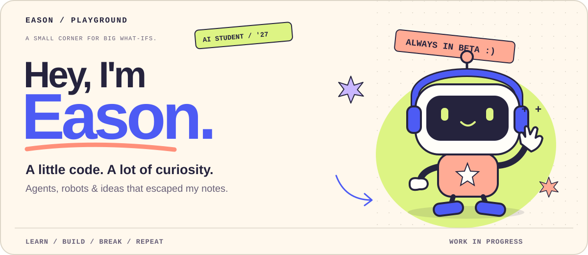
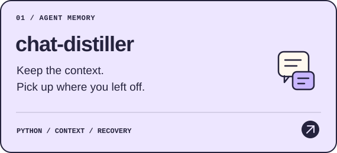
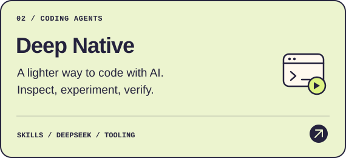
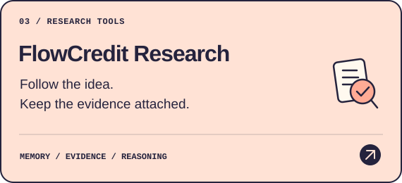
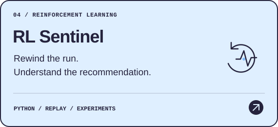
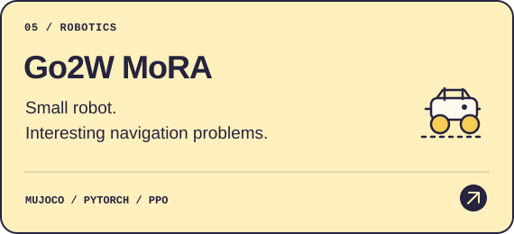
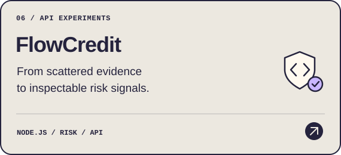

<picture>
  <source media="(prefers-color-scheme: dark) and (prefers-reduced-motion: no-preference)" srcset="assets/playground/hero-dark.svg">
  <source media="(prefers-reduced-motion: no-preference)" srcset="assets/playground/hero-light.svg">
  <source media="(prefers-color-scheme: dark)" srcset="assets/playground/hero-dark-static.svg">
  
</picture>

  <a href="#selected-projects">项目选集</a> &nbsp; · &nbsp;
  <a href="#current-focus">当前研究</a> &nbsp; · &nbsp;
  <a href="#my-philosophy">我的理念</a>

### 👋 关于我

**Eason · 人工智能本科生（AI undergraduate）· 2027 届**

我关注 **AI Agent、强化学习、具身智能**，也喜欢把抽象想法实现为真正可以运行、复现和检验的系统。

相比“做出了多少功能”，我更在意：**解决了什么问题、结果有多少证据支持、还有哪些事情尚未证明。** 我仍在学习，也愿意公开记录失败与修正。

> **生命会自己寻求出路。**
>
> 先明确值得抵达的目标，给智能体探索路径的空间，再让真实证据决定什么值得保留。  
> [我的 AI 编程理念：Life Finds a Way ↗](https://github.com/Anhao1314/life-finds-a-way)

## 🧩 项目选集

这些项目围绕 **智能体连续性、证据推理、强化学习实验与机器人导航** 展开。图片是项目入口；技术方案、实验结果和局限以各仓库的记录为准。

  
  

  
  

  
  

📋 查看文字版项目索引

| 项目 | 我在探索的问题 |
| :--- | :--- |
| [CarryTrace](https://github.com/Anhao1314/CarryTrace) | 长任务智能体如何保留上下文、决策依据与工作连续性。 |
| [Deep Native](https://github.com/Anhao1314/deep-native) | 编程智能体的技能与流程能否减少无效工作，而不是增加复杂度。 |
| [FlowCredit Research](https://github.com/Anhao1314/flowcredit-research) | 如何让研究结论与证据来源保持关联，并支持后续审查。 |
| [RL Sentinel](https://github.com/Anhao1314/RL-Sentinel) | 如何回放强化学习过程中的训练风险、事件和历史判断。 |
| [Go2W MoRA](https://github.com/Anhao1314/Go2w-MoRA-navigation) | 机器人在 MuJoCo 仿真中如何进行分层导航与实验验证。 |
| [FlowCredit](https://github.com/Anhao1314/flowcredit) | 如何将公开证据和确定性计算组织成可检查的风险信号。 |

## 🔬 当前研究

**01 · 具身智能与任务执行**  
[ G1 任务实验](https://github.com/Anhao1314/g1-jev-swarm-lab)：研究 MuJoCo 中的任务组织、执行反馈与失败处理。这是仿真研究，尚不构成真实机器人安全性的证明。

**02 · 智能体的持续工作能力**  
[CarryTrace](https://github.com/Anhao1314/CarryTrace)：探索如何在跨对话、跨阶段的工作中恢复必要的上下文与来源证据。

**03 · AI 辅助编程的方法验证**  
[Deep Native](https://github.com/Anhao1314/deep-native)：研究什么时候应减少工作流步骤、什么时候需要额外核验。首次小规模试验**尚未证明质量提升**，负面结果保留公开。

这里是人工整理的近期方向，不是实时动态。项目最新进展以对应仓库的提交与证据为准。

## 🌱 我的理念：生命会自己寻求出路

过去我经常替 AI 预先设计架构、拆分任务，再要求它沿着指定路线解决问题。后来我发现：代码和流程可能越来越多，但最初的问题不一定更接近解决。

现在，我更愿意把人和 AI 的分工理解为：

- **🎯 人负责目标。** 说明要解决什么、为什么值得做，以及资源和权限的边界。
- **🧭 AI 负责探索。** 在授权范围内选择方法，也可以用证据反驳不合理的初始方案。
- **🧪 证据负责筛选。** 保留成功、失败与未知，不为了让结果好看而修改历史。

这不是关于 AI 具有生命的主张，也不是已经被证明适用于所有开发任务的万能方法。

**[阅读完整的《生命会寻求自己的出路》研发宪章与个人反思 →](https://github.com/Anhao1314/life-finds-a-way)**

### 研究之外

我也会做一些创意编程、AI 视觉、小工具和界面实验。它们不一定都要成为产品，有些尝试只是为了看看一种想法究竟能否实现。

🗒️ 更多个人探索

创意编程 · AI 视觉 · 小工具 · 交互实验。

我还是学生。技术之外的好奇心也值得留一个位置，但不需要把每件尝试都包装成成果。

🧪 研究结论与适用边界

- **G1：** 目前是仿真研究（Simulation research），不代表真实机器人可靠性或安全性已被证明。
- **Deep Native：** 初次小规模对照**尚未证明质量提升**（did not show a quality improvement），不能以增加流程或测试数量冒充有效进步。
- **FlowCredit：** 仍属于实验性的证据与风险信号系统，不能当作**未经校准的信贷决策**依据（not calibrated lending decisions）。

项目仓库中的实验记录、限制说明与失败样本才是技术判断的依据；这份主页只提供入口。

🖼️ 关于封面与页面

封面机器人及项目插画是原创 SVG 装饰图，不是机器人实体照片或在线智能体状态。动画仅作装饰，不代表有模型正在运行。

本站使用仓库内图片和 GitHub 原生折叠面板，没有追踪组件或编造的指标。对减少动态效果的读者提供静态封面：[浅色](assets/playground/hero-light-static.svg) · [深色](assets/playground/hero-dark-static.svg)。

[查看设计与维护说明](docs/profile-design.md)

---

  <b>好奇心驱动探索，证据决定留下什么。</b>
   
  Eason / Anhao1314 · 学习、构建、验证、修正。

