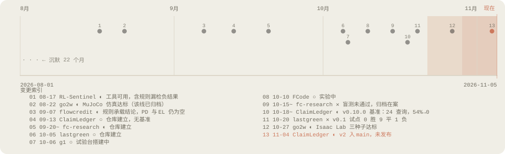

# Eason

[中文](README.md) · [English](README.en.md) · [视觉主页 ↗](https://anhao1314.github.io)

独立研究者。研究一个问题：**复杂系统的结论，如何不冒充现状。**研究假设展开见 [life-finds-a-way](https://github.com/Anhao1314/life-finds-a-way)。

> 人负责定义值得解决的问题。AI 负责探索道路。真实证据决定保留什么。

🔭 **观察点**　2026-08-01 → 2026-11-05

## 主线

[**ClaimLedger**](https://github.com/Anhao1314/ClaimLedger) — AI Agent 的决定台账：**声明 + 状态 + 来源**；冲突写入必须显式替代或提出争议，`--at` 重建任意时刻的认知。

`v0.10.0` · macOS / Linux · 纯标准库 · [基准报告](https://github.com/Anhao1314/ClaimLedger/blob/main/benchmarks/benchmark-results.md) · [发布](https://github.com/Anhao1314/ClaimLedger/releases/latest)

基准是合成的（40 会话 / 24 查询）：**样本小，勿外推**；冲突类 Recall@5 0.50。不做向量库、自动记忆捕获、守护进程、云同步。

## 声明台账

| 声明 | 证据 · 自 | 状态 |
| --- | --- | :---: |
| [ClaimLedger](https://github.com/Anhao1314/ClaimLedger)：过期结论不再冒充现状 | 24 合成查询，过期命中 54%→0 · 2026-10-18~ | ◐ |
| [FCode](https://github.com/Anhao1314/FCode)：模型只提案，事件落哈希链 | 实验中 · 2026-10-10 | ○ |
| [lastgreen](https://github.com/Anhao1314/lastgreen)：完成需要「最后一次绿」的证据 | v0.1 试点 0 胜 9 平 1 负，未证明 · 2026-10-20 | ✕ |
| [go2w-locomotion](https://github.com/Anhao1314/go2w-locomotion)：关节级 RL 可达实物 | Isaac Lab 三种子达标，sim2real 未开始 · 2026-10-27 | ◐ |
| [g1-jev-swarm-lab](https://github.com/Anhao1314/g1-jev-swarm-lab)：可支撑长时程任务 | 仍是目标而非结果 · 2026-10-06 | ○ |
| [RL-Sentinel](https://github.com/Anhao1314/RL-Sentinel)：训练失败可回放复查 | 工具可用，含规则漏检负结果 · 2026-08-17 | ◐ |
| [flowcredit](https://github.com/Anhao1314/flowcredit)：风险结论可校准 | 确定性规则承载，PD 与 EL 仍为空 · 2026-09-07 | ◐ |
| [flowcredit-research](https://github.com/Anhao1314/flowcredit-research)：投研观点可追溯 | 盲测未通过，归档在案 · 2026-10-15~ | ✕ |

## 检验记录

> 失败也是证据：没复现的、没通过的、证据不足的结果保留归档，按原样标注。

- **lastgreen v0.1**　10 组配对 0 胜 9 平 1 负 → 未证明；v0.2 的 12 次消融未运行；
- **flowcredit-research**　盲测未通过 → 归档；
- **go2w / g1**　结果都在仿真中，尚无域随机化与实物验证——仿真结果不等于实物可靠。

## 现在

- 📍 **在做**　ClaimLedger v2 争议闭合、双时态与依赖回溯已合入 main，未进发布；
- **未做**　go2w 的 sim2real 验证；g1 的长时程任务；
- **习惯**　小工具与创意编程保持试错的手感，不进正式仓库；
- 📮 **给 30 天后的我**　只信带日期与来源的行；其余是草稿。

## 校验

CI 用 [test_profile.py](tests/test_profile.py) 校验本页：声明集合与状态记号覆盖两份文件，章节顺序、宪法句与口径在此断言。检查器只验证结构与在场性，不验证真伪——**结论的真伪，在链接里。**

个人研究系统，非生产系统。未立声明者不上墙；带 ~ 为占位日期，待接入 ClaimLedger。

状态记号：**●** 已复现 · **◐** 有证据·样本小 · **○** 未证明 · **✕** 已证伪·在案 · **⚡︎** 争议中 —— **● 至今无一行适用。**

🌱 生命会自己寻求出路

