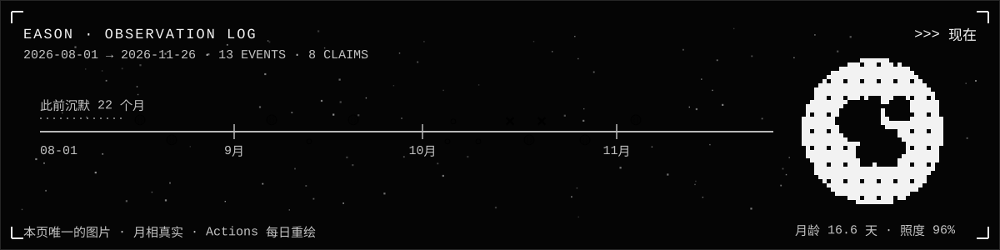

# Eason

[中文](README.md) · [English](README.en.md) · [视觉主页 ↗](https://anhao1314.github.io)

独立研究者。研究一个问题：**复杂系统的结论，如何不冒充现状**。研究假设展开见 [life-finds-a-way](https://github.com/Anhao1314/life-finds-a-way)。

<samp>人负责定义值得解决的问题 AI 负责探索道路 真实证据决定保留什么</samp>

🔭 **观察窗** 2026-08-01 → 现在

**✅ 至今无一行适用。** 记号含义：✅ 已复现 · 🟡 有证据·样本小 · ⚪ 未证明 · ❌ 已证伪·在案 · ⚡️ 争议中——本页所有记号只对齐事实，不对齐心情。

## 声明台账

- 🟡 **[ClaimLedger](https://github.com/Anhao1314/ClaimLedger)** — 过期结论不再冒充现状：声明 + 状态 + 来源，冲突写入必须显式替代或争议，`--at` 重建任意时刻的认知 · 24 合成查询，过期命中 54%→0 · 2026-10-18
- ⚪ **[FCode](https://github.com/Anhao1314/FCode)** — 模型只提案，每个事件落哈希链 · 实验中 · 2026-10-10
- ❌ **[lastgreen](https://github.com/Anhao1314/lastgreen)** — 完成需要「最后一次绿」的证据 · v0.1 试点 0 胜 9 平 1 负，未证明 · 2026-10-20
- 🟡 **[go2w-locomotion](https://github.com/Anhao1314/go2w-locomotion)** — 关节级 RL 可达实物 · Isaac Lab 三种子达标，sim2real 未开始 · 2026-10-27
- ⚪ **[g1-jev-swarm-lab](https://github.com/Anhao1314/g1-jev-swarm-lab)** — 可支撑长时程任务 · 仍是目标而非结果 · 2026-10-06
- 🟡 **[RL-Sentinel](https://github.com/Anhao1314/RL-Sentinel)** — 训练失败可回放复查 · 工具可用，含规则漏检负结果 · 2026-08-17
- 🟡 **[flowcredit](https://github.com/Anhao1314/flowcredit)** — 风险结论可校准 · 确定性规则承载，PD 与 EL 仍为空 · 2026-09-07
- ❌ **[flowcredit-research](https://github.com/Anhao1314/flowcredit-research)** — 投研观点可追溯 · 盲测未通过，归档在案 · 2026-10-15

## 败诉记录

> 失败也是证据：没复现的、没通过的、证据不足的结果保留归档，按原样标注。

- **lastgreen v0.1**　10 组配对 0 胜 9 平 1 负 → 未证明；v0.2 的 12 次消融未运行；
- **flowcredit-research**　盲测未通过 → 归档；
- **go2w / g1**　结果都在仿真中，尚无域随机化与实物验证——仿真结果不等于实物可靠。

## 现在

- **在做**　ClaimLedger v2 争议闭合、双时态与依赖回溯已合入 main，未进发布；
- **未做**　go2w 的 sim2real 验证；g1 的长时程任务；
- **习惯**　用小工具与创意编程保持试错的手感，不进正式仓库；
- **交接**　给 30 天后的我：只信带日期与来源的行，其余是草稿。

## 校验

观测板由 [generate_moon.py](scripts/generate_moon.py) 经 Actions 每日重绘，月相按真实日期计算；[test_profile.py](tests/test_profile.py) 断言结构与在场性——检查器只验证结构，不验证真伪，**结论的真伪，在链接里。**

个人研究系统，非生产系统。未立声明者不上墙。月亮的相位是真实的——**页面上其余的一切，用同样的标准要求自己。**

<samp><strong>生命会自己寻求出路</strong> LIFE FINDS A WAY</samp>

