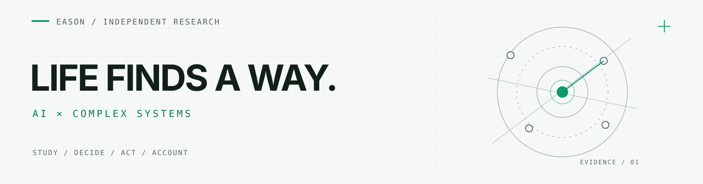

  <picture>
    <source media="(prefers-color-scheme: dark)" srcset="assets/profile-dark.svg">
    <source media="(prefers-color-scheme: light)" srcset="assets/profile-light.svg">
    
  </picture>

# Eason

[中文](README.md) · [English](README.en.md) · [视觉主页](https://anhao1314.github.io)

独立研究者，研究 **AI 与复杂系统**：智能如何研究、判断、行动，并对自己给出的结论负责。

> **生命会自己寻求出路。** Life finds a way.

**研究假设**　人负责定义值得解决的问题，AI 负责探索道路，真实证据决定保留什么。完整展开见 [life-finds-a-way](https://github.com/Anhao1314/life-finds-a-way)。

**核心问题**　怎样让复杂系统的结论可靠、可审计、不冒充现状。

> 仿真跑通 ≠ 现实可靠　·　检索命中 ≠ 结论现行　·　AI 输出 ≠ 可信依据

---

## 项目 · REPOS

这些仓库不共享架构，只共享一组问题：信息凭什么可信、Agent 能自主到什么程度、任务完成如何证明、仿真成功怎样变成现实能力。

### 证据原生 AI 与 Agent 运行时

| 仓库 | 一句话 | 状态 |
| --- | --- | --- |
| [ClaimLedger](https://github.com/Anhao1314/ClaimLedger) | AI Agent 的决定台账：带状态与溯源的声明库，过期结论不再冒充现状 | 开发中 |
| [FCode](https://github.com/Anhao1314/FCode) | host 治理的 Agent Runtime：模型只提案，每个事件落哈希链 | 实验中 |
| [lastgreen](https://github.com/Anhao1314/lastgreen) | 编程 Agent 的完成验证器：完成需要“最后一次绿”的证据 | 实验中 |

### 具身智能

| 仓库 | 一句话 | 状态 |
| --- | --- | --- |
| [go2w-locomotion](https://github.com/Anhao1314/go2w-locomotion) | Go2W 轮足导航（MuJoCo）已归档； Go2 关节级 RL（Isaac Lab）三种子达标，成功策略工件未公开 | 开发中 |
| [g1-jev-swarm-lab](https://github.com/Anhao1314/g1-jev-swarm-lab) | 单台 G1 试验台（MuJoCo）：任务图、严格判定，失败阻断依赖； 物理停机为 opt-in 实验路径 | 实验中 |
| [RL-Sentinel](https://github.com/Anhao1314/RL-Sentinel) | RL 训练的风险回放：失败、指标与当时的决策可复查，含规则漏检的负结果 | 工具 |

### AI 原生金融智能

| 仓库 | 一句话 | 状态 |
| --- | --- | --- |
| [flowcredit](https://github.com/Anhao1314/flowcredit) | 风险智能 API：确定性规则承载结论， 模型提取需显式同意，PD 与预期损失仍为空 | 维护中 |
| [flowcredit-research](https://github.com/Anhao1314/flowcredit-research) | 投研记忆与证据推理：观点可追溯、修订留痕， 模型无裁决权；盲测未通过 | 实验中 |

---

## 主线：ClaimLedger · LEDGER

　[v0.10.0](https://github.com/Anhao1314/ClaimLedger/releases/latest) · macOS / Linux · 纯标准库零依赖

长时程工作的记忆失效不是“检索不准”：过期结论仍被当作现行、冲突在读取时被静默合并、争议无人裁决。ClaimLedger 用 **声明 + 状态 + 来源** 组织记忆；冲突写入必须显式替代或提出争议，`--at` 可重建任意时刻的认知。

| 过期命中 @5 | Recall @5 | 工程验证 |
| :---: | :---: | :---: |
| **54% → 0** | **1.00 → 0.92** | **421 tests** |

数字来自[基准报告](https://github.com/Anhao1314/ClaimLedger/blob/main/benchmarks/benchmark-results.md)。拒绝清单同样重要：不做向量库、自动记忆捕获、守护进程或云同步。

**仍然存在的限制**　基准是合成的（40 个会话、24 个查询），只测检索；冲突类查询 Recall@5 降至 0.50，过期目标召回未测量。它管状态与来源，不判断真伪，不是 AI 记忆、Agent 可靠性或事实核验的通用解。

---

## 研发宪章 · CHARTER

- **目标先于路线。** 先说明为什么做、做到什么程度，再选方法；行业惯例不构成理由。
- **探索必须守界。** 自主选择方法，不等于自行获得新的权限、预算或发布授权。
- **失败也是证据。** 没复现的、没通过的、证据不足的结果保留归档，按原样标注。

---

## 边界，不藏在口号里 · LIMITS

- 这些是个人研究系统，不是生产系统；
- lastgreen 的 v0.1 试点是负结果（10 组配对中 0 胜 1 负 9 平），v0.2 的 12 次消融尚未运行：早期对照尚未证明质量提升；
- flowcredit 的风险结论不代表已经校准的信用评级；
- go2w 与 g1 的结果都在仿真中，尚无域随机化与实物验证：仿真结果不等于实物可靠。

---

## 校验 · VERIFY

CI 用 [test_profile.py](tests/test_profile.py) 校验本页：链接集合与状态词汇覆盖两份文件，章节顺序、身份短语与局限声明在中文页上断言；禁用词汇表与字节上限定义在检查器里。检查器只验证结构与在场性，不验证真伪——绿灯不是证明。

---

## 现在 · NOW

- **在做**　ClaimLedger v2 争议闭合、双时态与依赖回溯已合入 main，尚未进发布版；Phase B 与存储合并仅设计定稿。
- **未做**　go2w 的域随机化与 sim2real 验证；g1 的长时程任务仍是目标而非结果。
- **习惯**　用小工具与创意编程保持试错的手感——它们不进正式仓库。
